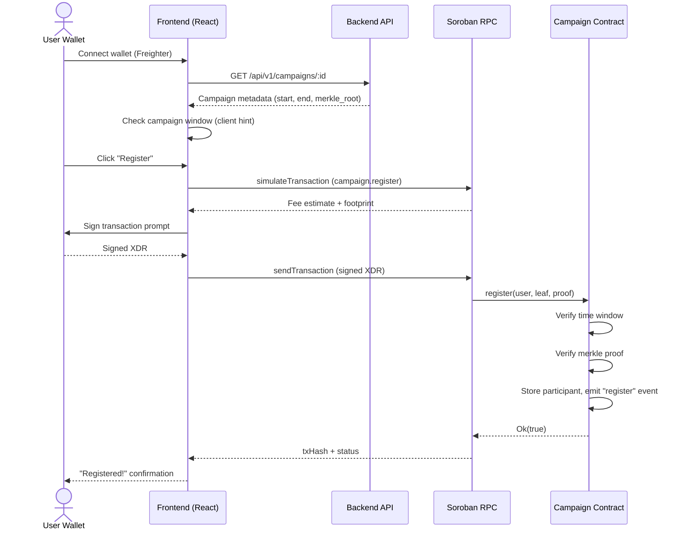
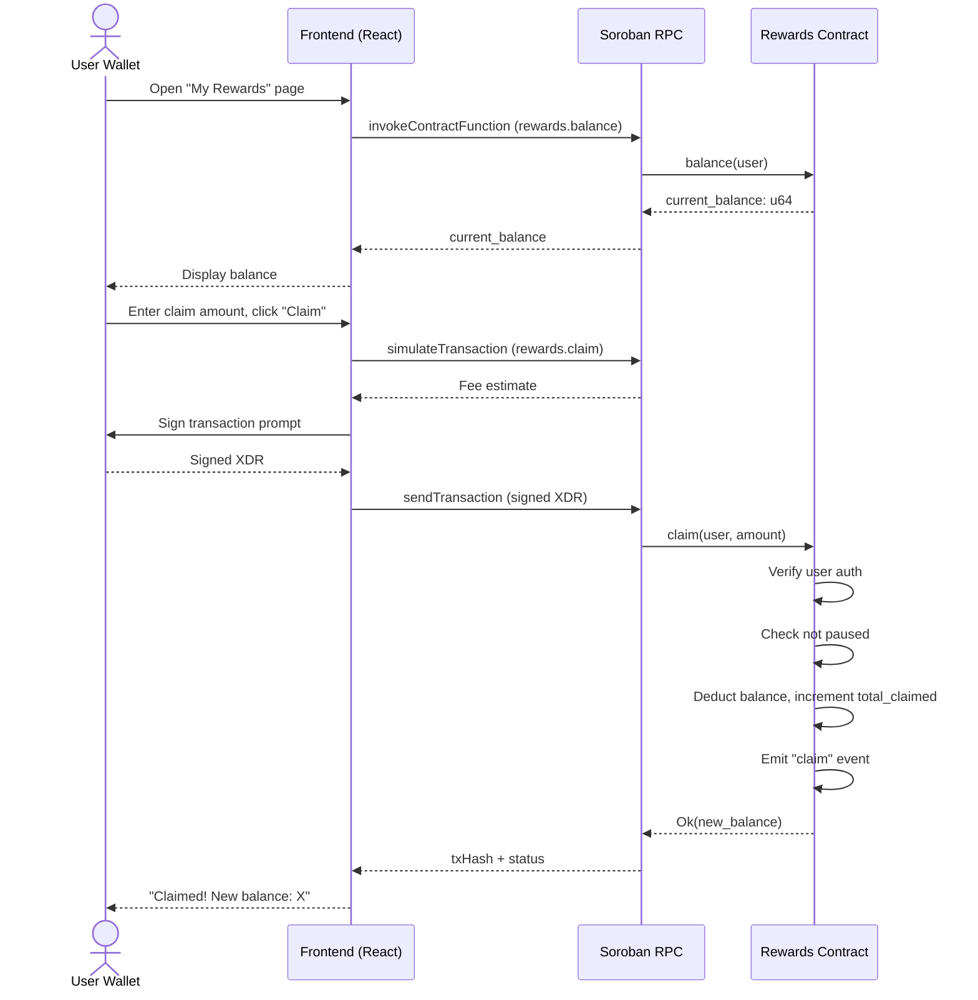
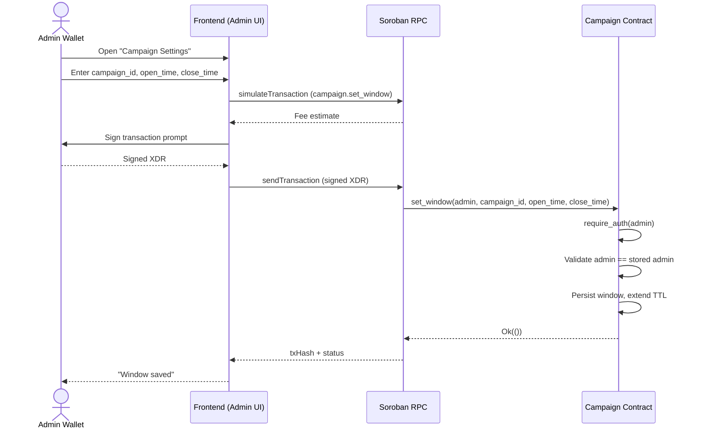
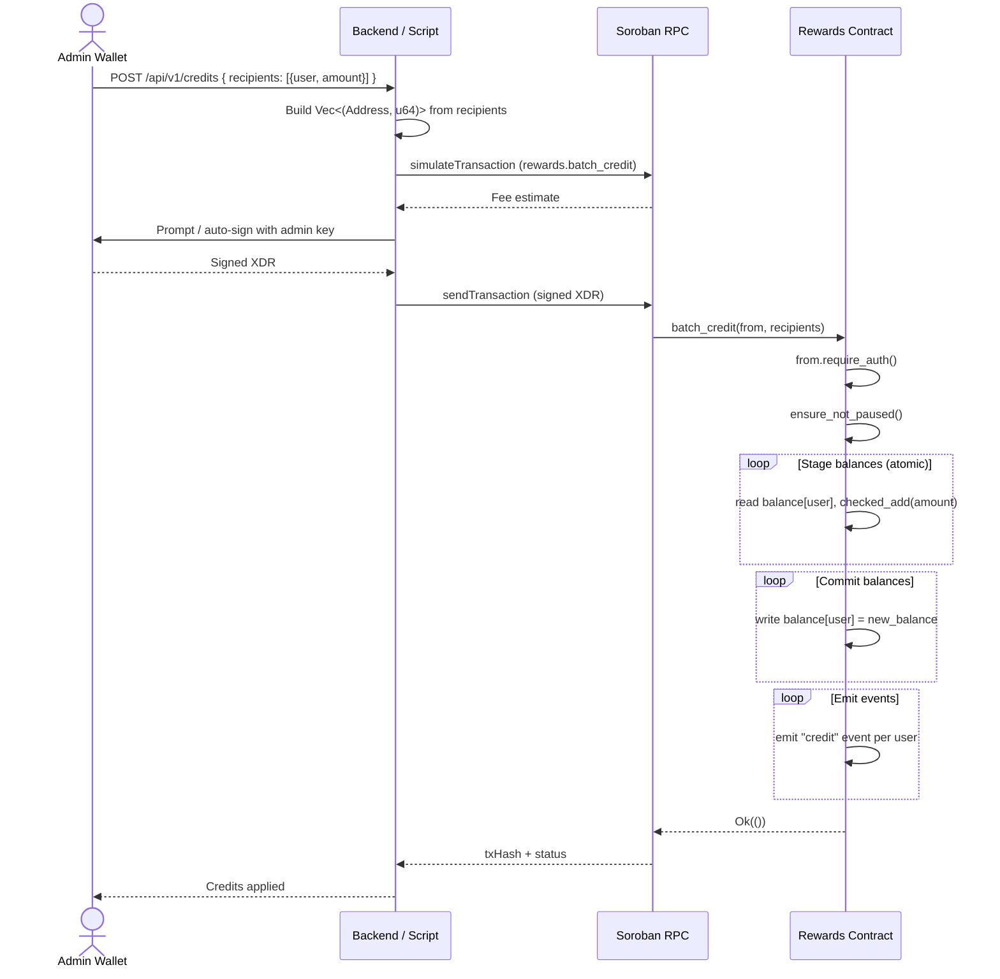
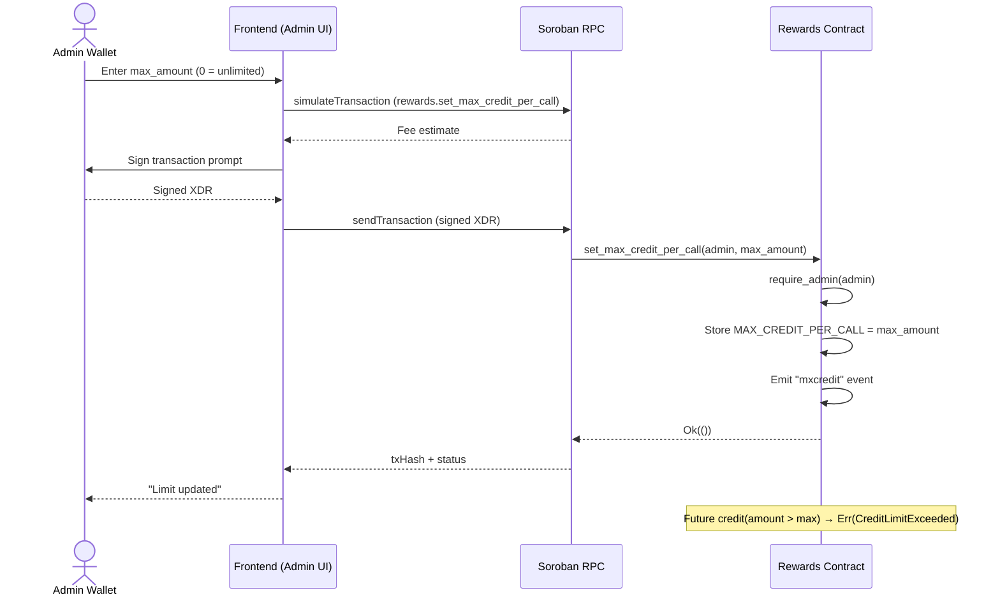
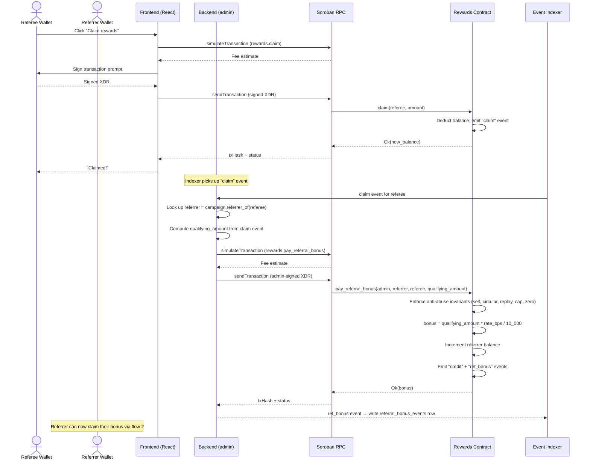

# Data Flow Diagrams

Detailed sequence diagrams for each core Trivela user journey. These complement the high-level
diagram in [ARCHITECTURE_OVERVIEW.md](ARCHITECTURE_OVERVIEW.md).

---

## 1. Campaign Registration

A user connects their wallet and registers as a participant in an active campaign.

---

## 2. Claim Rewards

A registered user claims part of their accrued points balance.

---

## 3. Admin: Set Campaign Time Window

An admin configures the open/close timestamps for campaign participation.

---

## 4. Admin: Credit Rewards (Batch)

An admin credits reward points to multiple users in a single transaction (#85).

---

## 5. Admin: Set Max Credit Per Call

An admin sets the upper bound on points per single `credit` call to prevent runaway crediting (#83).

---

## 6. Referral Claim Sub-flow

A referred user completes a qualifying action (claims rewards). The backend then pays the referral
bonus to the referrer via the rewards contract. See
[REFERRAL_REWARDS.md](REFERRAL_REWARDS.md) for the full reward-engine design and anti-abuse
invariants.

### Happy path

### Edge cases

#### Referrer wallet disconnected / inactive at bonus time

The referrer does not need to be online or connected. `pay_referral_bonus` credits the referrer's
**on-chain balance** directly; the referrer can call `claim` at any point in the future to withdraw
it. The bonus is not lost if the referrer is inactive.

#### Referred user never claims

The referral bonus is triggered by the referee's **qualifying action** (a successful `claim` on the
rewards contract). If the referee never claims, the backend never calls `pay_referral_bonus` and
the referrer receives no bonus. There is no timeout or expiry that auto-pays; the bonus is strictly
contingent on the referee completing the action.

#### Referral invariant violations

If the backend attempts `pay_referral_bonus` and an on-chain invariant is violated, the contract
returns an error and **no state is written** (all-or-nothing). The possible errors are:

| Scenario | Contract error |
|----------|---------------|
| Referee has already triggered a bonus for this referrer | `ReferralAlreadyRewarded` |
| Referrer and referee are the same address | `SelfReferral` |
| Circular referral (A referred B; B tries to bonus A) | `CircularReferral` |
| Referrer has hit their cumulative cap | `ReferralCapExceeded` |
| Computed bonus rounds down to zero | `ZeroReferralBonus` |
| Referral rate not configured | `ReferralNotConfigured` |

In all error cases the referee's claim still succeeds; only the referrer bonus is withheld.
